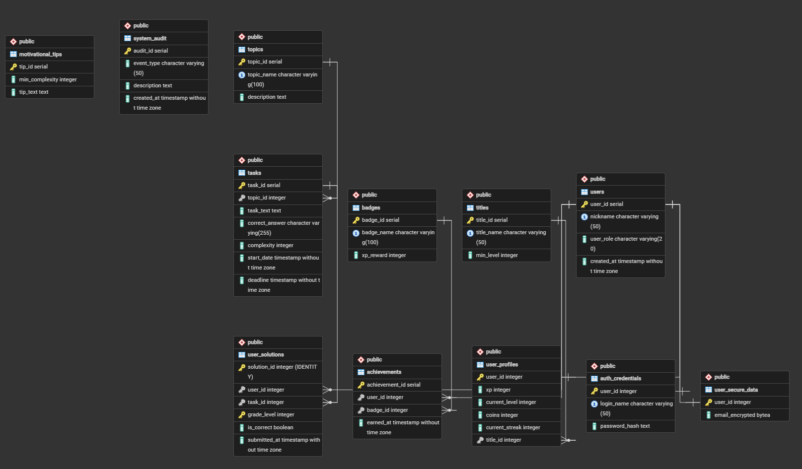

# Артём / Artem

### Junior Full-Stack & AI/ML Engineer | Data Specialist & DevOps/QA

Студент 3 курса IT-колледжа в Москве. Мультидисциплинарный специалист с упором на Backend, AI/ML и полный цикл работы с данными (Data Science, Analytics, Data Engineering). Умею не только проектировать модели и работать с архитектурой данных в СУБД, но и автоматизировать развертывание (DevOps) и тестирование (QA) ИТ-систем.

3rd-year IT college student based in Moscow. Multi-disciplinary engineer focused on Backend, AI/ML, and the full data lifecycle (Data Science, Analytics, Data Engineering). Skilled in designing models, managing database architecture, and automating IT deployment (DevOps) and testing (QA) pipelines.

---

## 📬 Контакты / Contacts

*   💬 **Telegram:** [@Ortemon_0](https://t.me/Ortemon_0)
*   📧 **Email:** [ortemon3469@gmail.com](mailto:ortemon3469@gmail.com)
*   📍 **Локация / Location:** Москва, Россия / Moscow, Russia

---

---

## 📈 Статистика GitHub / GitHub Stats

  
  

---
## 🛠 Технологический стек / Tech Stack

#### Data Engineering & Databases

#### Languages & Core Technologies

#### DevOps & Quality Assurance

*   **Data Engineering & Databases (Ру):** PostgreSQL, pgAdmin 4, проектирование реляционных баз данных, оптимизация SQL-запросов, обработка и структурирование потоков данных
*   **Data Engineering & Databases (Eng):** PostgreSQL, pgAdmin 4, relational database design, SQL query optimization, data stream processing and structuring
*   **Data Science & Analytics (Ру):** Сбор и глубокий анализ данных, выявление паттернов, подготовка датасетов, работа со статистикой
*   **Data Science & Analytics (Eng):** Data collection and deep analysis, pattern recognition, dataset preparation, applied statistics
*   **AI/ML & Agents (Ру):** Машинное обучение, проектирование и программирование автономных AI-агентов
*   **AI/ML & Agents (Eng):** Machine Learning, engineering and implementation of autonomous AI Agents
*   **Backend & Frontend (Ру):** Python, Java, Kotlin, JavaScript, TypeScript, HTML5, CSS3, интеграция API
*   **Backend & Frontend (Eng):** Python, Java, Kotlin, JavaScript, TypeScript, HTML5, CSS3, API integration
*   **DevOps & QA Automation (Ру):** Администрирование Ubuntu Linux, автоматизация на Bash, управление версиями Git, написание автотестов в Pytest
*   **DevOps & QA Automation (Eng):** Ubuntu Linux administration, Bash scripting, Git version control, test automation with Pytest

---

## 🚀 Проекты в этом репозитории / Projects in this Repository

| Название проекта / Project | Стек технологий / Tech Stack | Описание / Description | Ссылки / Links |
| :--- | :--- | :--- | :--- |
| **NardGo** | Java | **Ру:** Проект настольной игры в нарды на языке Java. **Eng:** A backgammon board game project implemented in Java. | [📂 Код / Code](./NardGo/) | 
| **Olimp Prep Web (projectOLimpPrepWEB314)** | HTML, CSS, JavaScript / TypeScript | **Ру:** Веб-страница для подготовки к олимпиадам по программированию. **Eng:** A web-based platform built for competitive programming and olympiad preparation. | [📂 Код / Code](./projectOLimpPrepWEB314/) | 
| **Gamified Educational Platform DB** | PostgreSQL, PL/pgSQL, pgcrypto, pgAdmin 4 | **Ру:** Реляционная БД образовательной платформы с партиционированием, PL/pgSQL процедурами, триггерами и RBAC. **Eng:** Relational DB for an educational platform featuring partitioning, PL/pgSQL procedures, triggers, and RBAC. | [📂 Код / Code](databaseproj/) |

 ### 📊 Дополнительно о проекте: Gamified Educational Platform Database

<b>📐 Нажмите, чтобы посмотреть ER-диаграмму базы данных / Click to view ER Diagram</b>

 

* **Архитектурные особенности:** Партиционирование таблицы решений `user_solutions` по классам (5–8 и 9–11), сложная бизнес-логика в процедуре `submit_answer_v4` (обработка дедлайнов, блокировки `FOR UPDATE`, начисление XP/монет, стриков и титулов).
* **Безопасность и автоматизация:** Шифрование конфиденциальных данных с помощью `pgcrypto`, триггеры аудита/валидации сложности задач и ролевая модель доступа (RBAC).

---

## 💼 Опыт и практика / Experience & Practice

**Учебно-практическая деятельность в IT-колледже** | *Сентябрь 2024 — По настоящее время*  
**Academic & Practical Experience at IT College** | *September 2024 — Present*  
> **Младший специалист по данным и разработке / Junior Data & Software Engineer**  
*   **Ру:** В рамках работы с данными (Data Engineering / Analytics / Data Science) проектировал сложные реляционные структуры в PostgreSQL через pgAdmin 4, писал оптимизированные SQL-запросы для извлечения метрик, занимался парсингом, фильтрацией и подготовкой датасетов для задач машинного обучения. Разрабатывал бэкенд на Python, Java, Kotlin и клиентские интерфейсы на HTML/CSS/JS. Обучал базовые ML-модели и настраивал логику AI-агентов. Выполнял задачи DevOps по администрированию Ubuntu Linux с написанием Bash-скриптов и обеспечивал качество кода (QA) через Pytest.
*   **Eng:** As part of data operations (Data Engineering / Analytics / Data Science), designed complex relational structures in PostgreSQL via pgAdmin 4, wrote optimized SQL queries for metrics extraction, and handled data scraping, filtering, and dataset preparation for ML tasks. Developed backends using Python, Java, Kotlin and frontend views with HTML/CSS/JS. Trained baseline ML models and built autonomous AI agents. Handled DevOps pipelines in Ubuntu Linux with Bash scripts and ensured code quality (QA) using Pytest.

---

## 🎓 Образование / Education

*   **Ру:** **IT-Колледж (Москва)** — Информационные системы и программирование, Студент 3 курса (Окончание в 2028)
*   **Eng:** **IT College (Moscow)** — Information Systems and Programming, 3rd-year student (Graduation: 2028)

---

## 🌐 Языки / Languages

*   **Ру:** Английский язык — Уровень A2 (Элементарный / Читаю техническую документацию, SQL-логи и документацию к библиотекам)
*   **Eng:** English — Level A2 (Elementary / Capable of reading tech docs, SQL logs, and library documentations)

---

## 🧠 Личные качества / Soft Skills

*   **Глубокий анализ данных и сферы (Ру):** Обладаю сильным аналитическим мышлением. Склонность докапываться до сути вопросов помогает мне скрупулезно изучать массивы данных, находить скрытые закономерности и эффективно вести профессиональные дискуссии.
*   **Deep Data & Domain Analysis (Eng):** Possess strong analytical thinking. A natural inclination to dig into the core of matters helps me meticulously study data blocks, uncover patterns, and engage productively in technical discussions.
*   **Поиск ошибок и перфекционизм (Ру):** Внимателен к мелким деталям как в коде, так и в выборках данных. Всегда ищу скрытые аномалии или ошибки в своей работе, направляя силы на улучшение и оптимизацию результатов.
*   **Error Hunting & Perfectionism (Eng):** Attentive to minor details in both code and data samples. Constantly scan for hidden anomalies or mistakes in my own output, driving efforts toward optimization.
*   **Коммуникация и усидчивость (Ру):** Обладаю средней коммуникабельностью, доброжелателен и всегда стараюсь понять позицию команды. Отличаюсь высокой усидчивостью при работе с монотонными задачами обработки данных и строго соблюдаю дедлайны.
*   **Collaboration & Persistence (Eng):** Balanced, approachable, and empathetic team member. Show high persistence during repetitive data processing tasks and maintain strict adherence to project deadlines.

